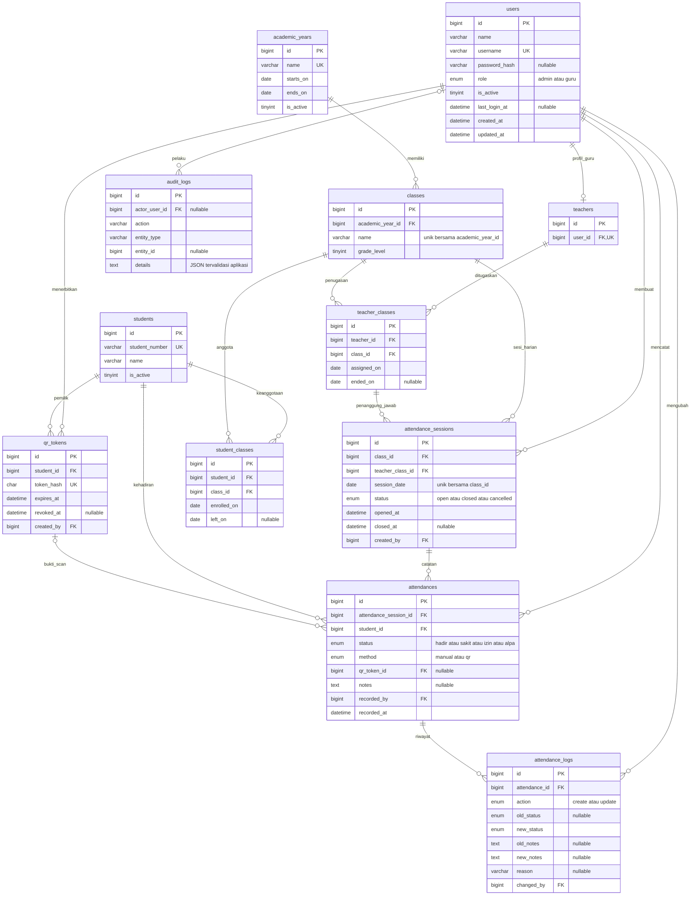

# Database absensi SD Negeri Purwodadi Simpang

Skema untuk PHP Native 8.1 dengan MySQL 5.7+ atau MariaDB 10.2+. Seluruh tabel memakai InnoDB dan default `utf8mb4_unicode_ci`. Kolom hash token saja memakai `ascii_bin` agar pencocokan heksadesimal bersifat eksak. Tidak ada ketergantungan pada `CHECK`, tipe `JSON`, fitur MySQL 8, atau trigger.

## Berkas dan pemasangan

- `migrations/001_initial_schema.sql`: membuat 12 tabel, foreign key, serta indeks.
- `seeds/development_seed.sql`: data fiktif untuk development, tanpa credential atau token QR.
- `ERD.md`: relasi dan kontrak validasi backend.

Buat dan pilih **database kosong** lewat konfigurasi lokal. Dari root proyek, contoh impor memakai client MySQL berikut; ganti `nama_database` dan `pengguna_lokal` dengan nilai lokal sebenarnya. Opsi `-p` meminta password database secara interaktif, bukan menyimpannya di repositori atau argumen command line.

```sh
mysql --default-character-set=utf8mb4 -u pengguna_lokal -p nama_database < database/migrations/001_initial_schema.sql
mysql --default-character-set=utf8mb4 -u pengguna_lokal -p nama_database < database/seeds/development_seed.sql
```

Client `mariadb` dapat dipakai dengan opsi setara. Kedua file dijalankan **sekali**, berurutan, tanpa `--force`. Migrasi tidak menggunakan `IF NOT EXISTS` agar perbedaan skema tidak tersembunyi. DDL MySQL melakukan implicit commit; jika migrasi gagal, periksa tabel yang terlanjur dibuat sebelum melanjutkan. Seed memakai transaksi dan ID tetap: bukan mekanisme upsert atau reset. Pada error seed, hentikan impor dan rollback koneksi; jangan lanjutkan hingga `COMMIT`. Client batch tanpa `--force` berhenti saat error dan transaksi yang belum commit dibatalkan saat koneksi ditutup. Jangan menjalankan seed pada database berisi data pengguna.

Aktifkan SQL mode strict, misalnya `STRICT_TRANS_TABLES`, pada koneksi aplikasi maupun impor. Tanpa strict mode, MySQL dapat mengonversi nilai `ENUM` tidak valid menjadi nilai kosong. Backend tetap memvalidasi enum, panjang string, tanggal, dan boolean `0/1` sebelum query. Simpan `DATETIME` sebagai UTC dan atur koneksi database ke `+00:00`; aplikasi menghitung `session_date` dan tanggal keanggotaan menurut zona sekolah `Asia/Jakarta`.

## ERD



ERD menampilkan kolom inti; SQL adalah sumber lengkap untuk timestamp dan indeks.

## Batas entitas dan riwayat

| Tabel | Fungsi dan batas penting |
| --- | --- |
| `users` | Kontrak Auth: tepat kolom `id`, `name`, `username`, `password_hash`, `role`, `is_active`, `last_login_at`, `created_at`, `updated_at`. Role hanya `admin`/`guru`; username unik dengan perbandingan tidak peka huruf besar-kecil sesuai collation. |
| `teachers` | Profil satu-ke-satu opsional pada user; untuk role guru wajib tersedia. Nama dibaca dari `users.name`, tidak diduplikasi. |
| `academic_years` | Rentang tahun ajaran; backend memastikan rentang valid dan maksimal satu tahun aktif. |
| `classes` | Kelas **per tahun ajaran**. `4A` tahun berikutnya adalah baris baru, bukan perubahan tahun pada kelas lama. Unik `(academic_year_id, name)`. |
| `teacher_classes` | Penugasan guru pada kelas, unik `(teacher_id, class_id)`. Beberapa guru boleh bertugas di kelas yang sama. Satu pasangan menyimpan satu rentang tanggal inklusif. |
| `students` | Identitas siswa stabil, tidak menyimpan kelas saat ini. `student_number` adalah nomor internal, bukan token QR. |
| `student_classes` | Tabel tambahan minimal untuk riwayat kelas siswa. Unik `(student_id, class_id)`; satu pasangan menyimpan satu rentang inklusif. |
| `qr_tokens` | Token acak milik siswa, tidak terikat kelas. Boleh ada riwayat token dicabut/kedaluwarsa; validitas kelas selalu diperiksa saat scan. |
| `attendance_sessions` | Satu sesi harian per kelas: unik `(class_id, session_date)`, termasuk sesi dibatalkan. Untuk dibuka ulang, gunakan baris yang sama dengan otorisasi dan audit, bukan membuat duplikat. |
| `attendances` | Unik **`(attendance_session_id, student_id)`**. Status wajib `hadir`, `sakit`, `izin`, atau `alpa`; tidak ada baris berarti belum dicatat, bukan otomatis alpa. |
| `attendance_logs` | Riwayat append-only pencatatan/koreksi kehadiran, termasuk status dan catatan sebelum/sesudah. |
| `audit_logs` | Audit tindakan umum seperti aktivasi akun, penggantian role, perubahan keanggotaan, penerbitan token, buka/tutup sesi. `entity_type`/`entity_id` merupakan referensi logis, bukan foreign key polimorfik. |

Saat naik kelas atau berganti tahun ajaran, tambahkan kelas, penugasan, dan keanggotaan baru; pertahankan baris lama. Untuk mutasi di tengah tahun, tutup `left_on` lama dan buat keanggotaan kelas tujuan tanpa tanggal bertumpang tindih. Rentang `NULL` berakhir efektif di `academic_years.ends_on`, bukan selamanya. Skema sederhana ini tidak memodelkan beberapa kali keluar-masuk pasangan kelas yang sama; kebutuhan tersebut memerlukan migrasi rentang terpisah nanti.

Laporan historis mengikuti `attendance_sessions.class_id -> classes.academic_year_id`, bukan kelas terbaru siswa atau tahun ajaran aktif. Daftar siswa yang belum dicatat diambil dari keanggotaan yang berlaku pada `session_date`, bukan hanya `students.is_active` saat laporan dibaca. Penonaktifan siswa/user tidak menghapus riwayat. Nama siswa dan guru tidak disalin sebagai snapshot; perubahan nama terlihat juga pada laporan lama.

Seluruh FK memakai `RESTRICT`, tanpa penghapusan berantai. Gunakan penonaktifan, penutupan rentang, pembatalan sesi, atau pencabutan token; hindari hard delete setelah data dipakai. Kolom relasi historis dan rentang yang telah dipakai absensi tidak boleh ditulis ulang sembarangan. Koreksi administratif harus memvalidasi ulang catatan terkait dan diaudit.

## Auth dan aktivasi akun development

Seed berisi dua akun **nonaktif**:

| Username | Role | Status awal |
| --- | --- | --- |
| `admin.demo` | `admin` | `is_active = 0`, `password_hash = NULL` |
| `guru.demo` | `guru` | `is_active = 0`, `password_hash = NULL`, sudah terhubung ke `teachers` dan kelas `4A` |

Tidak ada password bawaan. `NULL` bukan password kosong dan tidak boleh lolos login. Auth wajib menolak akun nonaktif atau hash `NULL` sebelum memanggil `password_verify()`. Saat sukses login, regenerasi ID sesi PHP, simpan identitas/role yang berasal dari server, dan perbarui `last_login_at`. Periksa ulang status aktif dan izin dari database pada operasi terlindungi agar sesi lama tidak mempertahankan akses sesudah akun dinonaktifkan atau role berubah. Database menyimpan identitas dan role; tidak ada tabel sesi login PHP dalam cakupan ini.

Aktivasi menggunakan **skrip CLI lokal `bin/create-user.php`**, bukan endpoint web. Skrip dibuat pada bagian implementasi aplikasi, bukan migrasi database; pastikan berkasnya sudah tersedia sebelum menjalankan perintah berikut. Kontrak input password memakai **STDIN noninteraktif**, bukan prompt tersembunyi, agar sederhana dan konsisten lintas platform.

Buat file teks sementara berisi satu baris password pada lokasi privat **di luar repositori dan webroot**, misalnya `C:/private/absensi-password.txt`. Batasi izin file hanya untuk pengguna lokal yang menjalankan CLI; jangan gunakan lokasi bersama atau folder sinkronisasi publik. Dari root proyek, jalankan melalui Command Prompt (`cmd.exe`) Windows atau shell yang mendukung redirect `<`:

```sh
php bin/create-user.php --username=admin.demo --role=admin --name="Admin Development" < "C:/private/absensi-password.txt"
```

Untuk akun guru, gunakan `--username=guru.demo --role=guru --name="Guru Development"` dengan file password privat tersendiri. **Hapus file sementara segera setelah digunakan**, termasuk jika perintah gagal. Jangan memasukkan password ke argumen command line, environment variable, seed, atau log. Operator `<` ini tidak didukung langsung oleh PowerShell; gunakan `cmd.exe` untuk contoh di atas.

Persyaratan implementasi CLI:

1. Hanya boleh berjalan pada PHP CLI, bukan endpoint web. Terima `--role=admin|guru`, `--username=...`, dan `--name=...`.
2. Baca password satu baris **hanya melalui STDIN yang di-redirect**; tolak input TTY/interaktif. Password minimal **12 byte** dan maksimal **72 byte**, tidak termasuk terminator baris. Jangan menerima password melalui argumen atau environment variable, mencetaknya ke log, maupun menyimpannya di berkas seed.
3. Hash dengan `password_hash($password, PASSWORD_DEFAULT)` PHP 8.1; simpan hasil pada `VARCHAR(255)`, set `is_active = 1` setelah seluruh langkah berhasil. Password mentah tidak masuk database.
4. Dalam transaksi, cari dan kunci user berdasarkan username. Untuk akun existing, **role harus sama** dengan argumen CLI; tolak setiap konflik role. Update baris yang sama dan pertahankan `users.id`, `teachers.id`, serta `teachers.user_id`. Jangan gunakan `REPLACE INTO`, delete/reinsert, atau membuat profil guru duplikat.
5. Untuk role guru, gunakan profil existing; buat `teachers` hanya jika belum ada. Untuk guru baru, buat user dan profil guru secara atomik. Perubahan role bukan fungsi CLI aktivasi ini dan memerlukan alur administrasi khusus yang diaudit.
6. Catat aktivasi/pembuatan akun di `audit_logs` tanpa credential. Skrip lokal tanpa sesi pengguna dapat memakai `actor_user_id = NULL` dan metadata sumber CLI.

## QR: proses server yang akan dibuat

Gunakan 32 byte acak kriptografis, misalnya PHP `bin2hex(random_bytes(32))`: payload berupa 64 karakter heksadesimal lowercase, **tanpa PII, NIS, nama, atau ID siswa**. Simpan hanya `hash('sha256', $rawToken)` di `qr_tokens.token_hash`; SHA-256 untuk token acak ini bukan pengganti `password_hash()` untuk password.

Tampilkan payload mentah sebagai QR hanya pada saat penerbitan; jangan simpan di tabel, URL query, log aplikasi, audit, maupun repositori. Jika hilang, terbitkan ulang dan cabut token lama. Untuk desain sederhana ini backend menerapkan maksimal satu token yang belum dicabut dan belum kedaluwarsa per siswa: kunci baris siswa, cabut token lama, lalu insert hash baru dalam transaksi. Indeks unik hash tidak menjamin aturan satu token aktif tersebut.

Saat scan, validasi format/panjang payload sebelum hashing, cari hash memakai prepared statement, lalu cek `revoked_at IS NULL`, `expires_at > waktu_UTC_sekarang`, dan `created_at <= waktu_UTC_sekarang`. Kunci token saat pencatatan agar pencabutan tidak berlomba dengan scan. Token reusable sampai dicabut/kedaluwarsa; batas satu kehadiran per sesi ditegakkan indeks unik. Token QR dapat disalin atau dibagikan: scan harus melalui pengguna berwenang dan sesi kelas yang benar, bukan endpoint publik yang menerima token sebagai satu-satunya otorisasi. Seed sengaja tidak mengisi tabel `qr_tokens`.

## Validasi backend yang wajib

FK memvalidasi keberadaan baris, **bukan seluruh aturan bisnis**. Jalankan validasi dan penulisan terkait dalam transaksi InnoDB dengan penguncian baris yang konsisten, termasuk pada perubahan penugasan/keanggotaan yang berpotensi berlomba dengan absensi.

### Tahun, kelas, dan keanggotaan

- Validasi `starts_on <= ends_on`, tingkat SD `1..6`, flag `0/1`, rentang penugasan/keanggotaan di dalam tahun ajaran, serta akhir rentang tidak lebih awal daripada awal.
- Maksimal satu tahun ajaran aktif ditangani backend dalam transaksi dengan serialisasi operasi pergantian tahun, misalnya mengunci seluruh baris tahun ajaran dalam urutan ID yang tetap. Flag aktif adalah pilihan operasional, bukan filter yang membuang sejarah.
- Pada satu tanggal, siswa hanya boleh memiliki satu keanggotaan kelas yang berlaku. Cek seluruh rentang lintas kelas/tahun, bukan hanya pasangan yang unik. Kunci baris siswa sebelum mutasi keanggotaan untuk mencegah dua penempatan bersamaan.
- Role user untuk profil/penugasan guru harus `guru`; guru dan akunnya harus aktif saat bertindak. Jangan menafsirkan keberadaan baris `teachers` saja sebagai izin.

### Sesi kelas dan otorisasi guru

- Bedakan sesi login PHP dengan `attendance_sessions`, yang merupakan sesi absensi harian kelas.
- FK komposit `(teacher_class_id, class_id)` memastikan assignment pada sesi memang milik kelas itu. Backend tetap memeriksa `session_date` berada dalam tahun ajaran kelas dan rentang `assigned_on..ended_on` efektif.
- Guru hanya boleh membuat/mengakses/mengisi sesi kelas yang sedang menjadi penugasannya. Saat membuat sesi, `teacher_class_id` harus milik guru tersebut; jangan percaya ID dari request. Saat guru lain ikut menangani kelas yang sama, periksa assignment guru yang sedang login juga. Guru tanpa penugasan aktif tidak boleh mengakses data kelas hanya dengan mengetahui ID sesi.
- Admin dapat mengelola semua kelas sesuai kebijakan aplikasi, tetapi tetap wajib memilih assignment penanggung jawab kelas yang valid. `created_by`/`recorded_by` diambil dari sesi login, bukan payload klien. Akses laporan historis memerlukan kebijakan eksplisit, bukan otomatis diberi hanya karena pernah bertugas.
- Hanya sesi `open` menerima pencatatan/scan normal. `closed` dan `cancelled` menolak perubahan normal. `closed_at` kosong untuk sesi terbuka dan diisi saat ditutup/dibatalkan. Pembukaan ulang dan koreksi setelah penutupan membutuhkan alur admin eksplisit dan audit. Laporan mengecualikan sesi `cancelled` secara default.
- Scan QR hanya untuk sesi bertanggal hari sekolah saat ini; absensi tanggal lampau/koreksi menggunakan alur manual berizin. Kunci baris sesi saat mencatat maupun menutup agar scan tidak lolos setelah sesi ditutup.

### Pencatatan, token, dan log

- Pastikan siswa aktif untuk pencatatan normal dan memiliki keanggotaan pada kelas sesi pada `session_date`. Jangan hanya mengecek bahwa `student_id` ada. Koreksi historis siswa nonaktif hanya melalui alur admin yang diaudit.
- Untuk `method = 'qr'`, `qr_token_id` wajib terisi, pemilik token harus sama dengan `attendances.student_id`, dan status harus `hadir`. Untuk `manual`, `qr_token_id` harus `NULL`. FK terpisah tidak memaksakan konsistensi ini.
- Kunci objek terkait sebelum memeriksa status/rentang, lalu insert atau koreksi secara eksplisit. Tangani konflik unique `(attendance_session_id, student_id)` sebagai scan berulang/konflik, bukan baris baru. Scan tidak boleh menimpa status `sakit`/`izin`/`alpa` secara diam-diam.
- Tidak ada auto-alpa di database. Saat finalisasi, backend boleh membuat `alpa` hanya untuk anggota yang valid pada tanggal sesi dan belum mempunyai catatan, dengan log dan transaksi yang sama.
- Setiap insert/update absensi wajib menulis `attendance_logs` dalam transaksi yang sama. `create`: `old_status` dan `old_notes` `NULL`; `update`: snapshot lama diambil dari baris terkunci. Simpan status/catatan baru, alasan koreksi, pelaku, dan waktu; perbarui `recorded_by`/`recorded_at` pada absensi. Perubahan metode/token dicatat pula pada metadata audit yang aman.
- Log bersifat append-only pada lapisan aplikasi; tidak ada trigger yang otomatis membuat log atau melarang modifikasi. Batasi hak akun database aplikasi sesuai kebutuhan, termasuk hak UPDATE/DELETE tabel log. `details` audit berupa JSON yang di-encode/validasi PHP, bukan string request mentah. Jangan catat password, hash password, payload QR, atau informasi pribadi yang tidak diperlukan.

## Pemeriksaan setelah impor

Pada database development kosong, hasil yang diharapkan: **12 tabel**, dua user nonaktif dengan hash `NULL`, satu guru, satu tahun ajaran, satu kelas, satu assignment guru, empat siswa, dan empat keanggotaan siswa. Lima tabel operasional/log masih kosong.

```sql
SHOW TABLES;
SELECT id, username, role, is_active, password_hash IS NULL AS belum_diaktivasi
FROM users ORDER BY id;
SELECT COUNT(*) AS jumlah_siswa FROM students;
SELECT COUNT(*) AS jumlah_keanggotaan FROM student_classes;
SELECT COUNT(*) AS jumlah_token FROM qr_tokens;
SHOW INDEX FROM attendances;
SHOW CREATE TABLE attendance_sessions;
```

Di database uji terpisah, uji bahwa duplikasi `(attendance_session_id, student_id)` dan assignment dari kelas berbeda ditolak database. Uji juga pada backend bahwa token kedaluwarsa/dicabut, siswa di luar kelas, guru tanpa assignment, akun seed nonaktif, dan sesi tertutup ditolak. SQL saja tidak membuktikan aturan aplikasi tersebut.
